# Sistema automático de consultas y pedidos

Automatización para pymes: un cliente completa un formulario y, sin que nadie toque nada, el pedido queda **registrado en una planilla**, el cliente recibe **un mail de confirmación** y el dueño recibe **un aviso** (marcado como urgente cuando corresponde).

> Proyecto de portfolio. El negocio, los datos y los mails son **ficticios** ("Ferretería y Repuestos El Tornillo").

**Video demo (54 s):** [Ver en Google Drive](https://drive.google.com/file/d/1SXqwPZAk6MtY9h0zf20KWLV6I_X-WHQq/view?usp=drive_link)

---

## Antes y después

- **Antes:** los pedidos llegaban por mensajes sueltos, se anotaban a mano y se perdían datos o se respondía tarde.
- **Ahora:** cada consulta entra por un formulario, queda ordenada en una planilla con estado y urgencia, y el cliente recibe confirmación al instante.
- **Resultado:** el dueño se entera en el momento, nada se pierde y el equipo sabe qué atender primero.

## Cómo funciona

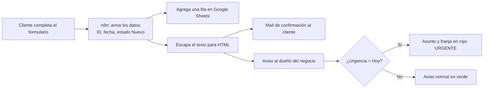

1. **Formulario** (n8n Form Trigger): nombre, mail, teléfono, tipo de consulta, rubro, detalle, cantidad, urgencia y retiro/envío.
2. **Datos del pedido:** se genera un ID (`PED-aammdd-hhmmss`), la fecha y hora, el estado inicial `Nuevo` y el responsable `Sin asignar`.
3. **Planilla:** se agrega una fila en Google Sheets. Las filas con urgencia "Hoy" se marcan en rojo.
4. **Texto seguro:** antes de armar los mails se escapan los caracteres especiales del texto del cliente.
5. **Mail al cliente:** confirmación con número de pedido, resumen y plazo de respuesta según la urgencia.
6. **Aviso al dueño:** resumen completo, asunto marcado como 🔴 URGENTE o 🟢 normal y botón para abrir la planilla.

## Capturas

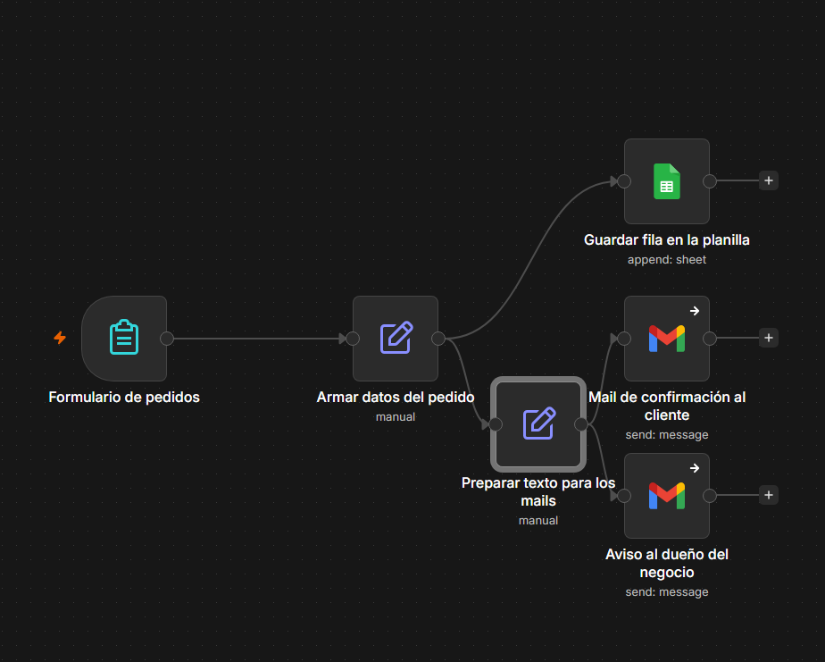

| Formulario | Planilla |
|---|---|
| 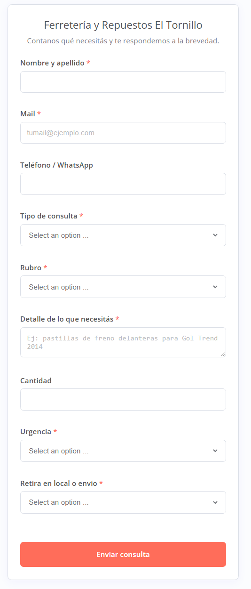 | 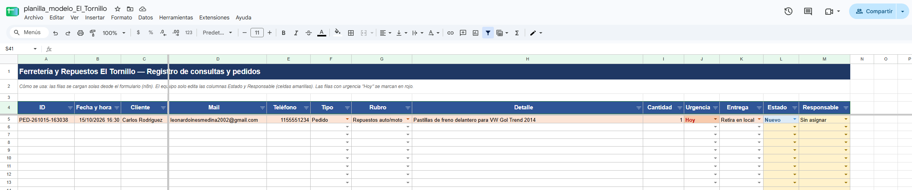 |

| Mail al cliente | Aviso al dueño |
|---|---|
| 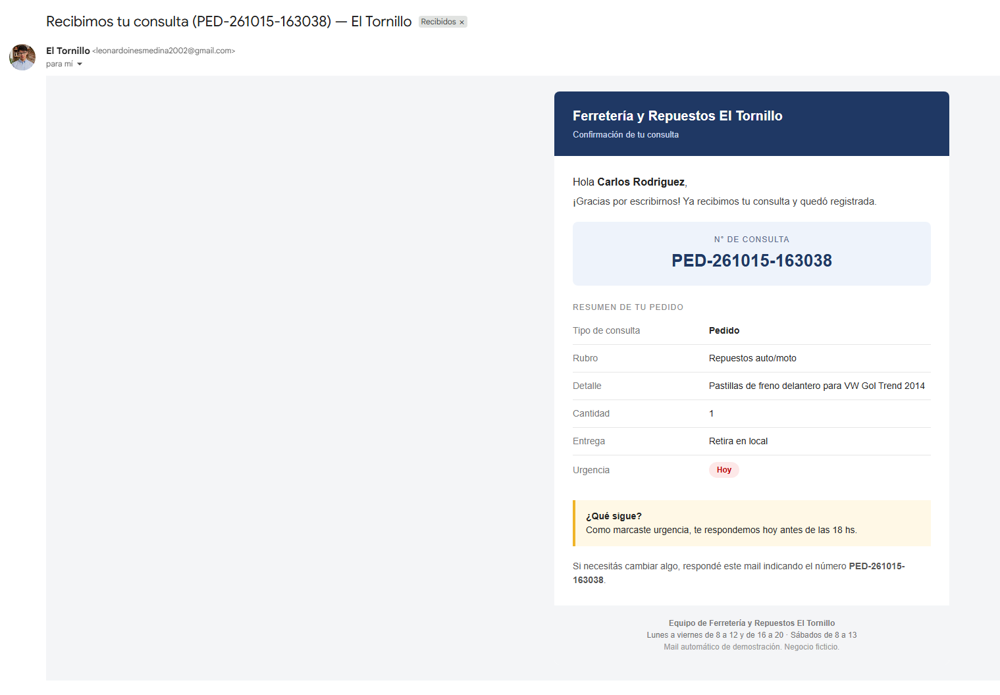 | 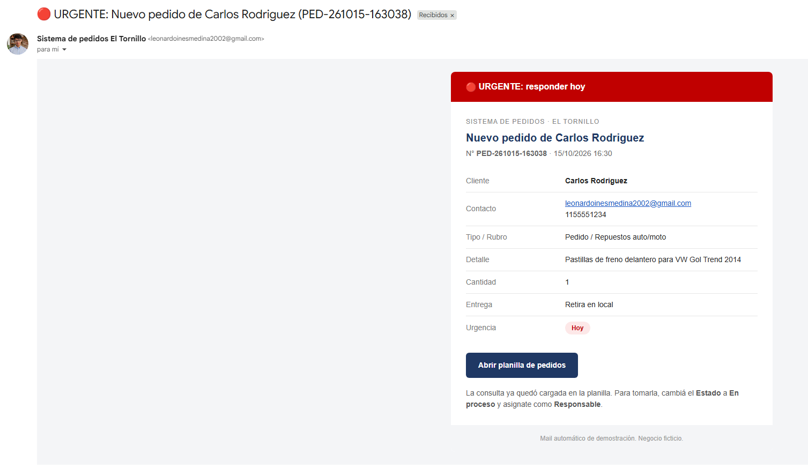 |

## Pruebas con caracteres especiales

Se probó el flujo con símbolos (`<8 mm> & "inox"`), apóstrofes, tildes, ñ, emojis, saltos de línea, etiquetas HTML (`<b>`, `<script>`), teléfonos con `+` y textos que empiezan con `=`. Los mails muestran el texto tal cual lo escribió el cliente.

| Caso 1: símbolos y comillas | Caso 2: tildes y emoji |
|---|---|
| 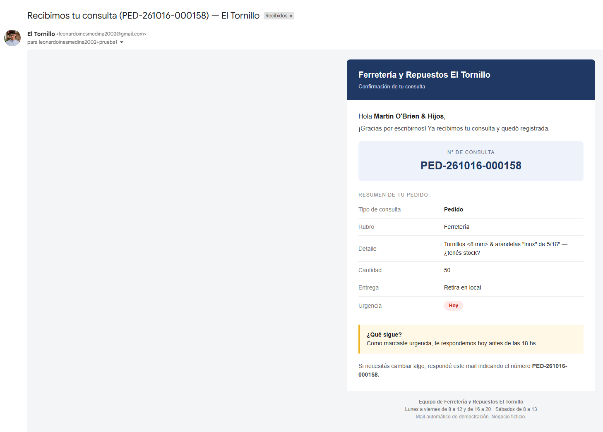 | 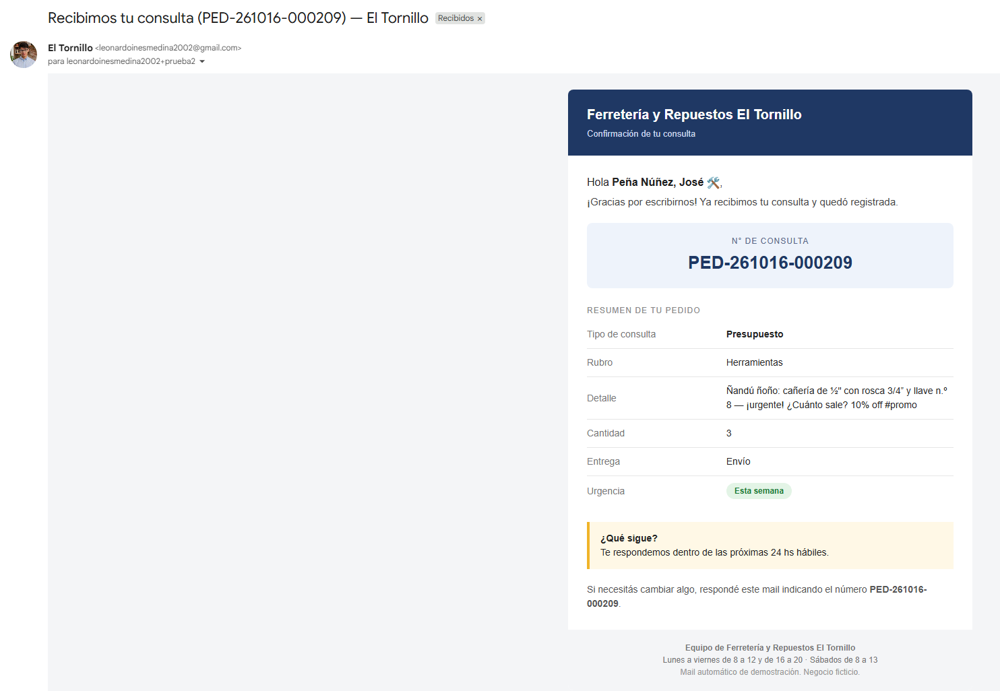 |

| Caso 3: HTML como texto (cliente) | Caso 3: HTML como texto (dueño) |
|---|---|
| 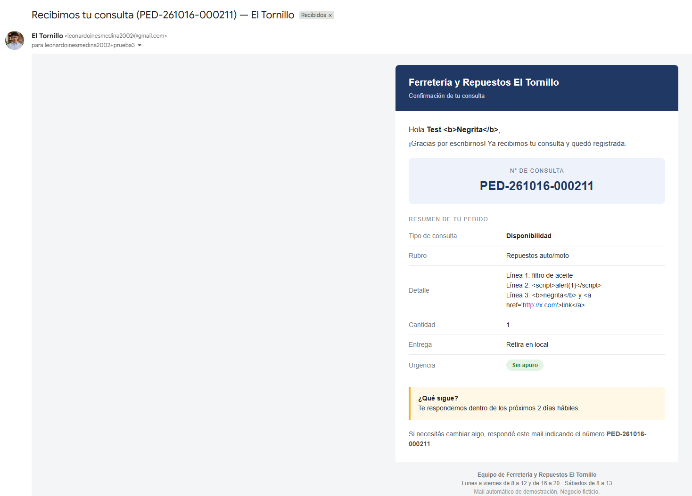 | 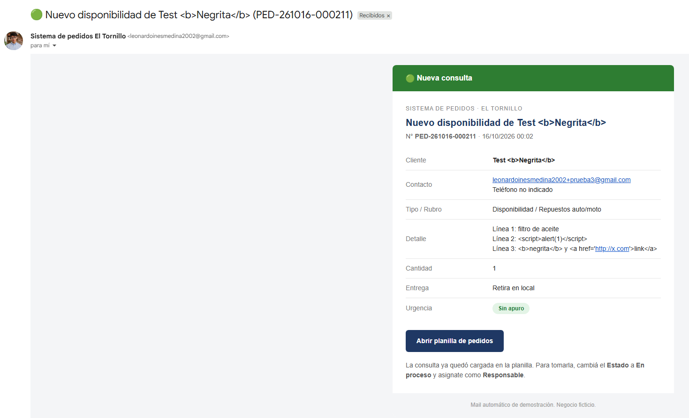 |

## Herramientas

n8n · Google Sheets · Gmail (HTML con estilos en línea)

## Planilla

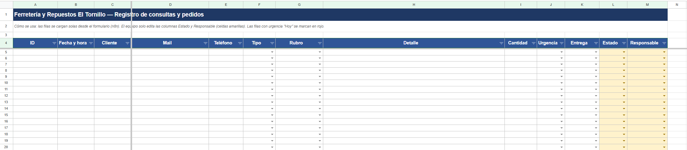

El archivo `planilla/planilla_modelo_El_Tornillo.xlsx` tiene 4 hojas:

- **Pedidos:** registro de consultas. Encabezados en la fila 4. Desplegables para Estado y Responsable, y formato condicional (fila roja si la urgencia es "Hoy" y el pedido no está en Listo o Entregado).
- **Resumen:** conteos por estado, urgencia y tipo.
- **Estados:** explicación del flujo `Nuevo → En proceso → Listo → Entregado`. `Nuevo` lo pone el sistema; los demás los cambia el equipo.
- **Listas:** origen de los desplegables.

## Cómo instalarlo

1. Importá `workflow/el-tornillo-consultas-y-pedidos.json` en n8n (menú ⋯ → *Import from file*).
2. Subí la planilla a Google Drive y abrila como Google Sheets.
3. En el nodo **Guardar fila en la planilla**: elegí tu documento y la hoja `Pedidos`. Los encabezados están en la **fila 4**.
4. Conectá tus credenciales de **Google Sheets** y **Gmail** (OAuth2) en los tres nodos que las usan.
5. En **Aviso al dueño del negocio** cambiá `dueno@tunegocio.com` por el mail real, y en el botón reemplazá `TU_ID_DE_PLANILLA` por el ID de tu planilla (en los dos mails si lo usás).
6. Publicá el flujo y abrí la URL del formulario.

## Cosas para tener en cuenta

- **Formulario público:** quien conozca la dirección puede disparar mails desde tu cuenta de Gmail a cualquier dirección. Publicalo solo mientras lo uses o agregá una validación o un captcha antes de usarlo con clientes reales.
- **Errores silenciosos:** los nodos de Gmail usan "continuar si falla", así que la ejecución sale en verde aunque un mail no salga. Revisá la salida del nodo si algo no llega (suele ser una credencial sin autorizar).
- **Caracteres especiales:** el nodo *Preparar texto para los mails* escapa el HTML (`& < > " '`) y convierte los saltos de línea en ` ` antes de armar los mails. La planilla guarda el texto original, y el nodo de Google Sheets usa formato `RAW`, así que un teléfono como `+54 9 11 5555-1234` o un texto que empiece con `=` no se interpreta como fórmula. Se probó con símbolos, comillas, tildes, ñ, emojis, saltos de línea, etiquetas HTML y textos largos.

## Ideas para seguir

- Tercer mail al cliente cuando el estado pase a **Listo** ("tu pedido está listo para retirar").
- Respuesta automática cuando falte un dato clave.
- Resumen diario de pedidos pendientes para el dueño.

---

_Contacto: leonardoinesmedina2002@gmail.com_
